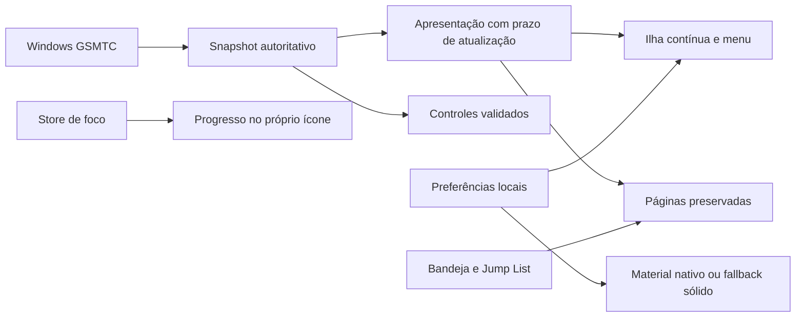

# System Design — evolução desktop do Pedro

## 1. Contexto e problema

- **Módulo:** continuidade de mídia, apresentação da ilha, navegação e integração do próprio aplicativo ao Windows.
- **Problema:** vazio entre faixas, recortes durante recolhimento e acesso dependente de quatro atalhos permanentes.
- **Restrições:** local-first, APIs oficiais, dados e atalhos existentes preservados; identidade industrial; nenhuma alteração do Explorer ou das preferências globais da taskbar.
- **Autorização:** implementação do plano de `ANALISE_VISUAL.md` aprovada pelo usuário. Bandeja, Jump Lists e progresso afetam apenas o Pedro.

## 2. Arquitetura atual vs proposta

- **Atual:** sessão autoritativa alterna diretamente entre player/vazio; ilha com árvores compacta/expandida separadas; páginas remontadas; dock permanente por padrão.
- **Proposta:** metadados de apresentação temporariamente retidos, mantendo a sessão real separada; cabeçalho único persistente; estados interrompíveis de apresentação; menu acessível; páginas visitadas preservadas; dock opcional; bandeja e atalhos próprios do Windows.

- **Componentes:** `useMediaStore`, `MusicPlayer`, `DynamicIsland`, `MainDashboard`, `AppearancePage`, preferências, `desktop_integration.rs`, `lib.rs` e wrappers IPC.

## 3. Dados e IPC

- Sessão real continua sendo a única identidade válida para comandos. Metadados retidos não autorizam ações; repetição de snapshot vazio não renova o prazo de retenção.
- Novos comandos: `configure_desktop_menu`, `apply_window_material`, `focus_taskbar_progress`, `desktop_initial_page`.
- Bandeja publica `pedro:preferences-patch` com campos validados; navegação reutiliza `pedro:navigate`.
- Jump Lists usam argumentos `--page` validados e instância única; lançamento frio mantém rota até a inscrição do frontend. Somente builds release configuram a lista, evitando que `tauri dev` substitua os destinos instalados.
- Materiais: `DwmSetWindowAttribute` somente no painel principal, com resposta de capacidade e fallback sólido. Widgets não recebem backdrop nativo, que preencheria suas margens transparentes. Nenhuma API privada de composição.
- Persistência: novos campos `nativeMaterial` e `sidebarCollapsed`; configuração explícita do dock preservada. SQLite, tabelas, triggers, centavos e IDs de sessão não mudam.

## 4. Riscos e mitigação

- **Foco/Shell:** widgets não recebem foco nativo em atualização/resize; menus de bandeja e Jump Lists abrem o painel somente por ação do usuário. Não manipular janelas internas do Explorer.
- **Concorrência:** revisões e sequências de mídia permanecem; prazos, animações e pedidos de tamanho antigos são cancelados ou ignorados. Instância única evita processos duplicados.
- **Transparência:** WebView transparente apenas para material próprio; caminho sem suporte usa CSS sólido. Janelas ocultas não permanecem como alvo invisível de clique.
- **Modais preservados:** páginas inativas são inert/hidden; portais e traps de foco são suspensos enquanto sua página está inativa.
- **Rollback:** selecionar material sólido, habilitar dock e expandir sidebar restaura alternativas tradicionais sem alterar dados. Reversão dos commits não exige migração do banco.

## 5. Estratégia de testes

- [x] `npm test`: 68 testes aprovados, incluindo continuidade, prazo, falhas, persistência e configuração.
- [x] `npm run build`: tipos e bundle aprovados.
- [x] Checagem Rust Windows GNU com lockfile e `--tests`, sem warnings; três políticas portáveis da integração desktop executadas no host.
- [x] Chromium: interrupções, menus por teclado, foco, páginas/modais preservados, temas e viewport compacto. A fronteira IPC do Windows foi simulada.
- [ ] Executável real Windows: WinRT, bandeja, Jump Lists, materiais, foco, taskbar e desempenho. Não confundir essa etapa com compilação cruzada.
